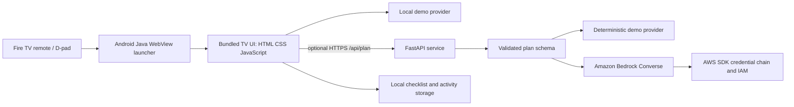

# ImpactSphere AI

**Turn intelligence into impact.** An offline-first, remote-friendly preparedness app for Amazon Fire TV. It provides family planning checklists, general safety guides, official public resources, and clearly labeled local plan examples. It does not detect emergencies or provide live alerts, shelters, evacuation routes, or emergency contacts.

> This is an early working build. The Android project and local web interface are implemented, but this host does not have Android Studio, Android SDK/ADB, Gradle, an AQC Fire TV Virtual Device, or a Fire TV device. It has not yet been built or run on Fire OS. Do not describe it as Fire TV-tested until that work is completed.

## Selected platform

**Fire OS (Android app with a bundled HTML/CSS/JavaScript interface).** Amazon states Fire OS is based on Android and uses the same Android tools and APIs. Vega OS also supports React Native and a webview template, but Amazon's current Vega setup guide says its developer tools require macOS or Linux; Windows and WSL are not supported. For this Windows 11 workspace, the Fire OS path is the practical target. A web page by itself is not the deliverable: the Android project in this repository is the intended installable app.

The hackathon rules require the app to run on Fire OS or Vega OS and the demo video to show it running on an actual Fire TV or Fire TV/Vega simulator. A generic desktop browser or Android emulator is useful for preliminary UI checks but does not satisfy that demonstration requirement.

## Features

- 16:9 TV layout with overscan-safe margins, large text, high-contrast cards, and visible remote focus.
- Five guide areas: floods, earthquakes, cyclones/storms, heatwaves, and family emergency planning. Guides link to Ready.gov source pages.
- Remote arrow-key navigation, select activation, and Android Back handling.
- Saved checklist completion and recent activity using on-device local storage.
- Trusted resource links; no fabricated live services or location-specific emergency facts.
- Deterministic, offline local plan examples labeled **LOCAL DEMO**.
- Optional FastAPI service with a Bedrock Converse provider. Bedrock uses the server's AWS SDK credential chain. The app never holds AWS secrets. The API validates a narrow plan schema and has no model tool execution.
- Setup, provider, and privacy status in Settings. A configured backend receives the question typed by the user; without one, plan examples are generated on-device.

## Architecture



## Technology stack

- Android application module, Java launcher, Android WebView, Android SDK API 35 compile target (minimum API 23; target API 28 for broad Fire OS compatibility).
- Bundled vanilla HTML/CSS/JavaScript UI; no JavaScript package manager or runtime dependency.
- Optional Python 3.11+ / FastAPI / Pydantic / boto3 backend.
- Amazon Bedrock Runtime Converse API, optional. The configured model ID, supported region, account access, IAM permission, and cost must be checked in the user's AWS account. This repository does not claim those have been verified.

## Windows 11 setup

### 1. Check tools

Run in PowerShell from this repository:

```powershell
Get-Command java, node, npm, python, git, adb, gradle -ErrorAction SilentlyContinue
java -version
node --version
python --version
adb version
```

Android Studio is not required to edit the interface, but is required for the supported Android build workflow. Install Android Studio from [developer.android.com/studio](https://developer.android.com/studio). In its Setup Wizard / SDK Manager, install Android SDK Platform 35, Android SDK Build-Tools, and Android SDK Platform-Tools. Use the JDK bundled with Android Studio (JDK 17 is suitable for the configured Android Gradle Plugin). Reopen PowerShell after installation, then confirm `adb version`.

### 2. Open and build the app

Open Android Studio, select **Open**, and choose this repository's root folder (the folder containing `settings.gradle`). Allow Gradle sync to finish. Android Studio may download the configured Gradle plugin and Android SDK components on first sync.

In Android Studio, choose **Build > Make Project** for a debug build. For a release APK, choose **Build > Generate Signed Bundle / APK > APK**, select the `release` variant, and create/use a signing key. Do not commit signing keys or passwords.

If you already have Gradle installed and on `PATH`, equivalent PowerShell commands from the repository root are:

```powershell
gradle assembleDebug
gradle assembleRelease
```

The debug APK is `app\build\outputs\apk\debug\app-debug.apk`. A release APK is unsigned unless you configure signing in Android Studio or Gradle.

### 3. Install on a Fire TV device

On the Fire TV, enable **ADB Debugging** and **Install unknown apps** under Developer Options. Find the device IP in network settings. Ensure the PC and TV are on the same network, then run (replace the sample IP):

```powershell
adb connect 192.168.1.50:5555
adb devices
adb install -r .\app\build\outputs\apk\debug\app-debug.apk
adb shell monkey -p org.impactsphere.tv 1
```

Amazon's docs explain that some Fire TV versions hide Developer Options until you select the About device entry seven times. Disconnect with `adb disconnect 192.168.1.50:5555` when finished.

### 4. Fire TV simulator

Use Amazon's **Fire TV Virtual Device in Appstore Quality Central (AQC)** or a Vega Virtual Device for the intended-platform demo. A Vega SDK/VVD install is currently not supported on this Windows host. The AQC Fire TV Virtual Device is a separate Amazon tool; it is not the standard Android Studio phone emulator. Follow its current AQC install/test workflow, then install and launch the debug APK using the mechanism provided by AQC. No AQC-specific command is included here because it is not installed or verified in this environment. A real Fire TV device is the documented fallback.

## Optional Bedrock backend

The app defaults to its on-device demo. To use Bedrock, deploy the `backend` service behind HTTPS, then enter its base URL in **Settings** on the TV app. Keep the service private or protected by your own authentication and usage controls; the included endpoint is a prototype and is not an internet-ready public service. Never put AWS credentials in the Android app.

From PowerShell, in a separate terminal:

```powershell
cd .\backend
py -3.11 -m venv .venv
.\.venv\Scripts\Activate.ps1
python -m pip install -r requirements.txt
$env:IMPACTSPHERE_PROVIDER = 'demo'
python -m uvicorn app:app --host 127.0.0.1 --port 8000
```

For Bedrock, first configure AWS credentials with an appropriate role/profile using AWS's supported setup; grant only the required `bedrock:InvokeModel` permission for the selected model. Then set the backend environment (model IDs and region differ by account and current availability):

```powershell
$env:IMPACTSPHERE_PROVIDER = 'bedrock'
$env:BEDROCK_MODEL_ID = '<model-id-or-inference-profile-id-available-in-your-account>'
$env:AWS_REGION = '<supported-region>'
python -m uvicorn app:app --host 127.0.0.1 --port 8000
```

For a real TV, the backend must be reachable over HTTPS from that TV; `127.0.0.1` on the developer computer is not reachable as the TV's backend. No model access, AWS authentication, region, IAM policy, or pricing has been checked in an AWS account as part of this repository setup. In the Bedrock console, verify model availability and access for the selected region, check current pricing, and set a budget before enabling inference.

## Checks

Backend unit checks:

```powershell
cd .\backend
python -m unittest -v
```

Manual Fire TV QA still required: build and start on an AQC Fire TV Virtual Device or physical Fire TV; test all D-pad directions and focus visibility, Back behavior, each guide and screen, persistence after process restart, backend success/error and demo labeling, and 1080p/responsive safe areas. No Fire OS emulator/device test, app screenshot, or video has been produced yet.

## Hackathon readiness checklist

- [ ] Create/register the Devpost project and select the Fire TV primary track.
- [ ] Build the APK and prove it runs on a Fire TV device or AQC Fire TV Virtual Device.
- [ ] Capture real app screenshots and record a sub-three-minute public YouTube/Vimeo demo on the target platform.
- [ ] Publish this source with this MIT license, or follow the private-repository reviewer-sharing requirements.
- [ ] Fill in product feedback after actually using each submitted tool/API/SDK. Draft prompts are below; do not submit them as firsthand feedback until verified.
- [ ] If claiming AWS Builder, document the Bedrock configuration, AWS services, region, model, permissions, and costs actually used.

## Product feedback worksheet (not yet firsthand feedback)

Tools/frameworks considered: Android Studio / Android SDK / Fire OS WebView; optional FastAPI, boto3, and Bedrock Runtime Converse. Vega SDK was checked and not selected because its current official setup instructions do not support Windows.

After onboarding, report: what worked in setup/docs/testing/performance/reliability; what was confusing or missing; time-to-first-run; whether you would build with it again and why. Record exact versions and any error/workaround. Do not claim to have used Android Studio, AQC, Vega, AWS, or Bedrock until those steps are performed.

## Sources

- [Amazon Appstore developer portal](https://developer.amazon.com/apps-and-games)
- [Fire TV getting started](https://developer.amazon.com/docs/fire-tv/get-started-with-fire-tv.html)
- [Connect to Fire TV through ADB](https://developer.amazon.com/docs/fire-tv/connecting-adb-to-device.html)
- [Amazon Vega getting started (Windows/WSL limitation and VVD)](https://developer.amazon.com/apps-and-games/blogs/2026/07/guide-to-building-for-fire-tv-on-vega-os)
- [Build a Vega app](https://developer.amazon.com/docs/vega/latest/build-an-app)
- [Hackathon official rules](https://amazonappdev2026.devpost.com/rules)
- [Ready.gov: floods](https://www.ready.gov/floods), [earthquakes](https://www.ready.gov/earthquakes), [hurricanes](https://www.ready.gov/hurricanes), [extreme heat](https://www.ready.gov/heat), and [family planning](https://www.ready.gov/plan)
- [Bedrock Converse API](https://docs.aws.amazon.com/bedrock/latest/userguide/conversation-inference.html), [model access](https://docs.aws.amazon.com/bedrock/latest/userguide/model-access.html), and [regional availability](https://docs.aws.amazon.com/bedrock/latest/userguide/models-region-compatibility.html)

## Existing code and license

This workspace was empty when implementation began. The source added here was created for this project. General disaster-preparedness summaries are linked to the official public Ready.gov pages listed above; no external code or imagery was copied. See [LICENSE](LICENSE).
